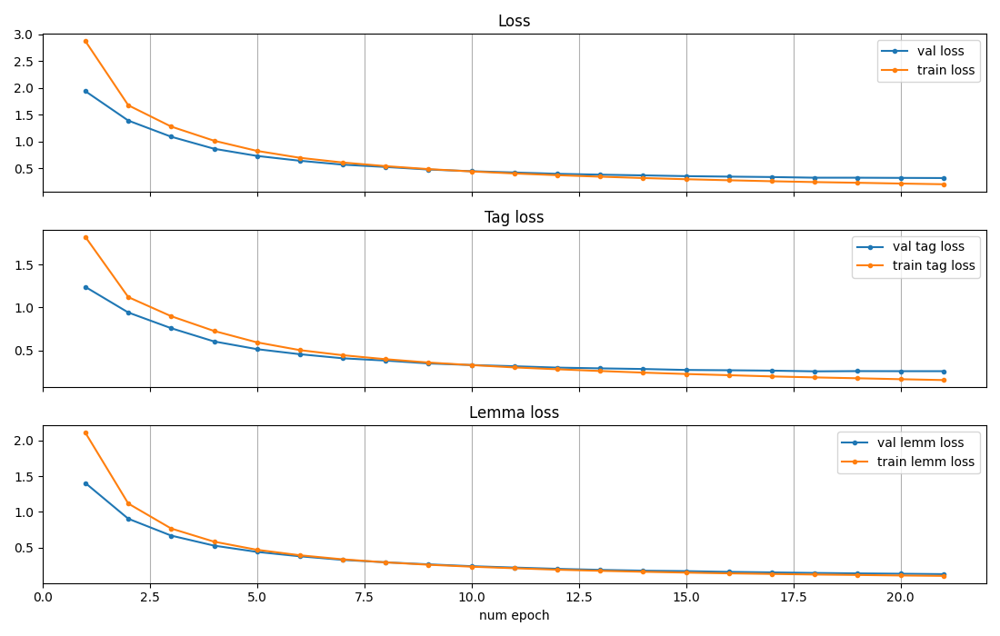
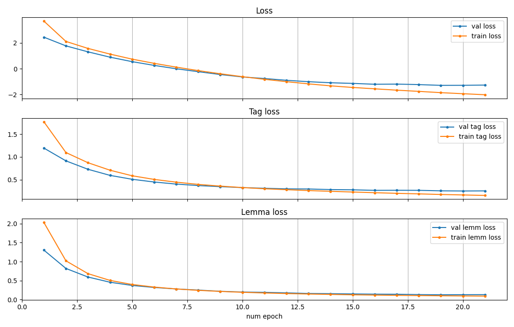

# Лемматизатор для русского языка

## Постановка задачи

Ставится задача построит алгоритм, который каждому слову в предложении ставит в соответствие лемму и частиречный тег. Пунктуационные знаки не учитываются.

## Набор данных для обучения и тестирования

Для обучения и тестирования алгоритма взять размеченный корпус русского языка Ru Taiga. [1] Набор данных уже разделен на обучающу, валидационную и тестовую выборки.

Исходя из поставленной задачи из набора данных удалены токены и соответствующие определения для них, которые содержали в себе символы других алфавитов, пунткуационные знаки, специальные символы. Леммы приводились к нижнему регистру, т.к. регистр в поставленной задаче не имеет значения.

Также обучающий и валидационный наборы были сокращены для уменьшения вычислительной сложности.

Реализация процесса обучения и тестирования, а также другие вспомогательные функции и классы реализованы в файле *utils.py*

## Алгоритм для решения задачи

В качестве алгоритма для решения задачи выбрана нейросетевая модель LemmaTag [2], точнее ее упрощенная версия, ввиду эффективности модели для морфологически богатых языков и низкой требовательности к данным.

В качестве весовых коэффициентов для функции потерь при предсказании тега и генерации леммы рассмотрены константные параметры из статьи [2] и два обучаемых параметра на основе работы [3]. Графики метрик обучения для первого и второго вариантов на рис. 1 и 2 соответственно. Для каждого случая сохранялись лучшие параметры на основе метрики на валидационной выборке.

Рис. 1 – Метрики на обучении при постоянных весовых коэффициентов

Рис. 2 – Метрики на обучении при изменяемых весовых коэффициентов0.831658

Реализация модели приведена в файле *model.py*

## Оценка качества

Оценка качества производилась на отложенной, тестовой, выборке. Метриками качества являются доля угаданных тегов и доля угаданных символов в леммах для классификации тегов и построения лемм соответственно. Доли рассчитывается по всему объему тегов и лемм вне зависимости от предложения.

Качество на валидационной выборке каждой модели в табл. ниже. Вариант 1 обозначает постоянные коэффициенты для функции потерь, вариант 2 – обучаемые.

| вариант | tag_accuracy | lemma_accuracy |
| -------------- | ------------ | -------------- |
| 1              | 0,9198430    | 0,8208447      |
| 2              | 0,9165719    | 0,8125608      |

Как видно из таблицы разницы в метриках между вариантами почти нет. Для оценки тестовой выборки выбрана модель с постоянными весовыми коэффициентами: *tag_accuracy* 0,923385, *lemma_accuracy* 0,831658.

Качество только на тех тесовых словах, которых не было в обучающей выборке: *tag_accuracy* 0,756362, *lemma_accuracy* 0,386862. При такой проверке каждое слово составляло отдельное предложение.

Пример работы:

**Вход**:

*Стала стабильнее экономическая и политическая обстановка, предприятия вывели из тени зарплаты сотрудников.*

*Все Гришины одноклассники уже побывали за границей, он был чуть ли не единственным, кого не вывозили никуда дальше Красной Пахры.*

**Выход**:

*стала{стать=VERB} стабильнее{стабильный=ADJ} экономическая{экономический=ADJ} и{и=CCONJ} политическая{политический=ADJ} обстановка{обстановка=NOUN} предприятия{предприятие=NOUN} вывели{вывести=VERB} из{из=ADP} тени{тень=NOUN} зарплаты{зарплата=NOUN} сотрудников{сотрудник=NOUN}*

*все{весь=DET} гришины{гришина=ADJ} одноклассники{однокцивский=ADJ} уже{уже=ADV} побывали{побывать=VERB} за{за=ADP} границей{граница=NOUN} он{он=PRON} был{быть=AUX} чуть{чуть=ADV} ли{ли=PART} не{не=PART} единственным{единственный=ADJ} кого{кто=PRON} не{не=PART} вывозили{вывозить=VERB} никуда{никуда=ADV} дальше{дальше=ADV} красной{красный=ADJ} пахры{пахра=NOUN}*

## Список использованных источников

1. Universal Dependencies dataset. URL: [hdl.handle.net/11234/1-6149](http://hdl.handle.net/11234/1-6149) (дата обращения 18.10.2026)
2. Kondratyuk D. et al. LemmaTag: Jointly tagging and lemmatizing for morphologically rich languages with BRNNs //Proceedings of the 2018 Conference on Empirical Methods in Natural Language Processing. – 2018. – С. 4921-4928.
3. Kendall A., Gal Y., Cipolla R. Multi-task learning using uncertainty to weigh losses for scene geometry and semantics //Proceedings of the IEEE conference on computer vision and pattern recognition. – 2018. – С. 7482-7491.
